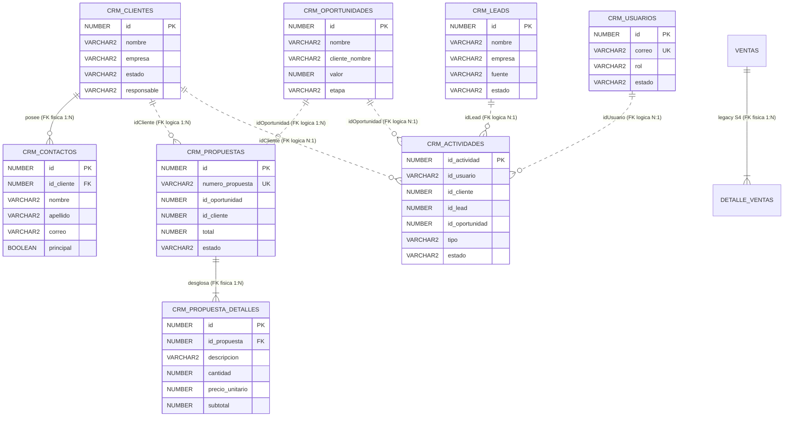

# Auditoría del Modelo de Datos — Viernes CRM V1
## Inspección previa a la ampliación de relaciones Muchos a Muchos (N:M)

**Fecha:** 19 de Octubre de 2026  
**Tipo de auditoría:** Solo lectura (Inspección estática de código + Inspección dinámica en Oracle 23c y Keycloak 25)  
**Alcance:** Monorepo `Viernes` (`viernes-backend`, esquema `BOM_VENTAS@FREEPDB1`, configuraciones OIDC)  
**Estado general:** 🟢 Sistema operativo, pero **con modelo de datos 100% 1:N o desacoplado por IDs lógicos; existen CERO relaciones N:M implementadas en JPA y Oracle**.

---

## 1. Inventario Real de Entidades y Tablas

### 1.1. Entidades JPA en Backend (`viernes-backend`)

Se identificaron **8 entidades JPA** en el código fuente:

| # | Entidad JPA | Paquete / Módulo | Tabla Oracle Mapeada | Estrategia ID | Anotaciones Relevantes |
|---|---|---|---|---|---|
| 1 | `ClienteEntity` | `com.viernes.clientes...` | `CRM_CLIENTES` | `IDENTITY` | `@OneToMany(mappedBy = "cliente", cascade = ALL, orphanRemoval = true)` |
| 2 | `ContactoEntity` | `com.viernes.clientes...` | `CRM_CONTACTOS` | `IDENTITY` | `@ManyToOne(fetch = LAZY) @JoinColumn(name = "ID_CLIENTE")` |
| 3 | `LeadEntity` | `com.viernes.leads...` | `CRM_LEADS` | `IDENTITY` | `@Enumerated(STRING) estado` |
| 4 | `OportunidadEntity` | `com.viernes.oportunidades...` | `CRM_OPORTUNIDADES` | `IDENTITY` | `@Enumerated(STRING) etapa`, `BigDecimal valor` |
| 5 | `PropuestaEntity` | `com.viernes.propuestas...` | `CRM_PROPUESTAS` | `IDENTITY` | `@OneToMany(cascade = ALL, orphanRemoval = true, fetch = EAGER) @JoinColumn(name = "ID_PROPUESTA")` |
| 6 | `DetallePropuestaEntity` | `com.viernes.propuestas...` | `CRM_PROPUESTA_DETALLES` | `IDENTITY` | Sin `@ManyToOne` explícito (hijo unidireccional de Propuesta) |
| 7 | `ActividadEntity` | `com.viernes.actividades...` | `CRM_ACTIVIDADES` | `IDENTITY` | Claves foráneas lógicas como tipos escalares (`idUsuario`, `idCliente`, `idLead`, `idOportunidad`) |
| 8 | `UsuarioEntity` | `com.viernes.usuarios...` | `CRM_USUARIOS` | `IDENTITY` | `@Enumerated(STRING) rol`, `unique = true` en `CORREO` |

> [!NOTE]
> **No existen entidades JPA para:** `Producto`, `Organización`, `Persona`, `Equipo`, `Campaña`, `Fuente` ni ninguna tabla intermedia asociativa (`@ManyToMany` o `@JoinTable`).

---

### 1.2. Inventario de Tablas en Oracle Database (`BOM_VENTAS@FREEPDB1`)

La consulta al catálogo `USER_TABLES` reveló **10 tablas físicas** en el esquema `BOM_VENTAS`: 8 correspondientes al CRM y 2 tablas heredadas del módulo didáctico de ventas (`VENTAS`, `DETALLE_VENTAS`).

| Tabla Física | Registros Actuales | Rol en el Sistema | Clave Primaria (PK) | Claves Foráneas Físicas (FK) | Restricciones de Unicidad (UK) |
|---|:---:|---|---|---|---|
| `CRM_CLIENTES` | 4 | Principal (Empresas) | `ID` (PK) | *Ninguna* | *Ninguna* |
| `CRM_CONTACTOS` | 4 | Subrecurso (Personas) | `ID` (PK) | `ID_CLIENTE` ➔ `CRM_CLIENTES(ID)` | *Ninguna* |
| `CRM_LEADS` | 2 | Principal (Prospectos) | `ID` (PK) | *Ninguna* | *Ninguna* |
| `CRM_OPORTUNIDADES` | 3 | Principal (Pipeline) | `ID` (PK) | *Ninguna* | *Ninguna* |
| `CRM_PROPUESTAS` | 0 | Principal (Cotizaciones) | `ID` (PK) | *Ninguna* | `NUMERO_PROPUESTA` (UK) |
| `CRM_PROPUESTA_DETALLES` | 0 | Detalle (Ítems) | `ID` (PK) | `ID_PROPUESTA` ➔ `CRM_PROPUESTAS(ID)` | *Ninguna* |
| `CRM_ACTIVIDADES` | 2 | Transversal (Tareas) | `ID_ACTIVIDAD` (PK) | *Ninguna* | *Ninguna* |
| `CRM_USUARIOS` | 2 | Seguridad local | `ID` (PK) | *Ninguna* | `CORREO` (UK) |
| `VENTAS` | 0 | *Heredada (LP2 S4)* | `ID` (PK) | *Ninguna* | *Ninguna* |
| `DETALLE_VENTAS` | 0 | *Heredada (LP2 S4)* | `ID` (PK) | `ID_VENTA` ➔ `VENTAS(ID)` | *Ninguna* |

---

### 1.3. Detalle de Columnas y Tipos de Datos en Oracle

```text
CRM_CLIENTES:
  - ID                NUMBER(19,0) NOT NULL (PK, IDENTITY)
  - NOMBRE            VARCHAR2(600) NOT NULL
  - EMPRESA           VARCHAR2(600) NULL
  - CORREO            VARCHAR2(600) NULL
  - TELEFONO          VARCHAR2(120) NULL
  - ESTADO            VARCHAR2(80) NOT NULL
  - RESPONSABLE       VARCHAR2(400) NULL
  - CREADO_EN         TIMESTAMP(9) NOT NULL

CRM_CONTACTOS:
  - ID                NUMBER(19,0) NOT NULL (PK, IDENTITY)
  - ID_CLIENTE        NUMBER(19,0) NOT NULL (FK -> CRM_CLIENTES.ID)
  - NOMBRE            VARCHAR2(400) NOT NULL
  - APELLIDO          VARCHAR2(400) NULL
  - CARGO             VARCHAR2(400) NULL
  - CORREO            VARCHAR2(600) NULL
  - TELEFONO          VARCHAR2(120) NULL
  - PRINCIPAL         BOOLEAN(1) NULL
  - CREADO_EN         TIMESTAMP(9) NOT NULL

CRM_LEADS:
  - ID                NUMBER(19,0) NOT NULL (PK, IDENTITY)
  - NOMBRE            VARCHAR2(600) NOT NULL
  - EMPRESA           VARCHAR2(600) NULL
  - CORREO            VARCHAR2(600) NULL
  - TELEFONO          VARCHAR2(120) NULL
  - FUENTE            VARCHAR2(320) NULL
  - ESTADO            VARCHAR2(80) NOT NULL
  - RESPONSABLE       VARCHAR2(400) NULL
  - FECHA             DATE NULL
  - CREADO_EN         TIMESTAMP(9) NOT NULL

CRM_OPORTUNIDADES:
  - ID                NUMBER(19,0) NOT NULL (PK, IDENTITY)
  - NOMBRE            VARCHAR2(800) NOT NULL
  - CLIENTE_NOMBRE    VARCHAR2(600) NULL (Desnormalizado, texto libre)
  - VALOR             NUMBER(14,2) NULL
  - PROBABILIDAD      NUMBER(10,0) NULL
  - ETAPA             VARCHAR2(80) NOT NULL
  - RESPONSABLE       VARCHAR2(400) NULL
  - FECHA_CIERRE      DATE NULL
  - CREADO_EN         TIMESTAMP(9) NOT NULL

CRM_PROPUESTAS:
  - ID                NUMBER(19,0) NOT NULL (PK, IDENTITY)
  - NUMERO_PROPUESTA  VARCHAR2(200) NOT NULL (UK)
  - ID_OPORTUNIDAD    NUMBER(19,0) NOT NULL (FK lógica, sin constraint física)
  - ID_CLIENTE        NUMBER(19,0) NOT NULL (FK lógica, sin constraint física)
  - CLIENTE_NOMBRE    VARCHAR2(600) NULL
  - ESTADO            VARCHAR2(80) NOT NULL
  - VERSION           NUMBER(10,0) NOT NULL
  - SUBTOTAL          NUMBER(14,2) NOT NULL
  - DESCUENTO         NUMBER(14,2) NOT NULL
  - TOTAL             NUMBER(14,2) NOT NULL
  - RESPONSABLE       VARCHAR2(400) NULL
  - FECHA_EMISION     DATE NOT NULL
  - FECHA_VENCIMIENTO DATE NULL
  - OBSERVACIONES     CLOB NULL
  - CREADO_EN         TIMESTAMP(9) NOT NULL

CRM_PROPUESTA_DETALLES:
  - ID                NUMBER(19,0) NOT NULL (PK, IDENTITY)
  - ID_PROPUESTA      NUMBER(19,0) NOT NULL (FK -> CRM_PROPUESTAS.ID)
  - DESCRIPCION       VARCHAR2(2000) NOT NULL
  - CANTIDAD          NUMBER(10,0) NOT NULL
  - PRECIO_UNITARIO   NUMBER(14,2) NOT NULL
  - SUBTOTAL          NUMBER(14,2) NOT NULL

CRM_ACTIVIDADES:
  - ID_ACTIVIDAD      NUMBER(19,0) NOT NULL (PK, IDENTITY)
  - ID_USUARIO        VARCHAR2(1020) NULL (FK lógica a usuario / correo)
  - ID_CLIENTE        NUMBER(19,0) NULL (FK lógica, sin constraint física)
  - ID_LEAD           NUMBER(19,0) NULL (FK lógica, sin constraint física)
  - ID_OPORTUNIDAD    NUMBER(19,0) NULL (FK lógica, sin constraint física)
  - TIPO              VARCHAR2(1020) NOT NULL
  - TITULO            VARCHAR2(1020) NOT NULL
  - DESCRIPCION       CLOB NULL
  - FECHA             TIMESTAMP(9) NOT NULL
  - ESTADO            VARCHAR2(1020) NOT NULL
  - CREADO_EN         TIMESTAMP(9) NOT NULL

CRM_USUARIOS:
  - ID                NUMBER(19,0) NOT NULL (PK, IDENTITY)
  - NOMBRE            VARCHAR2(400) NOT NULL
  - APELLIDO          VARCHAR2(400) NOT NULL
  - CORREO            VARCHAR2(600) NOT NULL (UK)
  - PASSWORD_HASH     VARCHAR2(1020) NOT NULL
  - ROL               VARCHAR2(80) NOT NULL
  - ESTADO            VARCHAR2(80) NOT NULL
  - CREADO_EN         TIMESTAMP(9) NOT NULL
  - ACTUALIZADO_EN    TIMESTAMP(9) NULL
```

---

## 2. Diagrama Entidad-Relación (Estado Actual)

El siguiente diagrama refleja fielmente la estructura física y lógica en ejecución:
- Las líneas continuas (`--`) representan **claves foráneas físicas (FK)** en Oracle.
- Las líneas punteadas (`..`) representan **relaciones lógicas por ID desacopladas** (mantenidas por código Java sin restricción referencial en la base de datos).



---

## 3. Verificación de Relaciones Comerciales

A continuación se audita cada una de las relaciones solicitadas:

| Relación Comercial Solicitada | Clasificación del Hallazgo | Implementación Actual | Cardinalidad Real | FKs y Tablas Implicadas | ¿Permite N:M? | Detalle Técnico |
|---|---|---|---|---|:---:|---|
| **Clientes y Contactos** | **Existente y verificado** | JPA `@OneToMany` + `@ManyToOne` | **1:N** | `CRM_CONTACTOS.ID_CLIENTE` ➔ `CRM_CLIENTES.ID` | ❌ **No** | Un contacto pertenece estrictamente a un cliente. Si un contacto asesora a 2 clientes, debe duplicarse. `orphanRemoval=true` elimina contactos al borrar el cliente. |
| **Organizaciones y Personas** | **Ausente** | No existen como entidades separadas | **N/A** | Ninguna | ❌ **No** | `CRM_CLIENTES` combina persona jurídica o natural. `CRM_CONTACTOS` solo guarda personas supeditadas a una empresa. |
| **Oportunidades y Contactos Participantes** | **Ausente** | Desconexión total | **0:0** | Ninguna (`CRM_OPORTUNIDADES` no conoce contactos) | ❌ **No** | No existe `ID_CONTACTO` ni tabla intermedia `OPORTUNIDAD_CONTACTOS`. |
| **Oportunidades y Productos** | **Ausente** | Solo existe campo monetario `VALOR` | **0:0** | Ninguna (No existe entidad Producto en CRM) | ❌ **No** | No hay ítems en oportunidades ni catálogo de productos vinculado. |
| **Actividades y Personas (Contactos)** | **Ausente** | Desconexión con contactos | **0:0** | `CRM_ACTIVIDADES` no tiene `ID_CONTACTO` | ❌ **No** | Las actividades no pueden asociarse a personas de contacto externas, solo al operador del sistema (`idUsuario`). |
| **Actividades y Organizaciones (Clientes)** | **Incompleto** | Campo escalar `idCliente` en `ActividadEntity` | **N:1** (Lógica) | `CRM_ACTIVIDADES.ID_CLIENTE` (Sin constraint física en Oracle) | ❌ **No** | Una actividad solo puede asociarse a 1 cliente. No permite múltiples organizaciones. |
| **Actividades y Oportunidades** | **Incompleto** | Campo escalar `idOportunidad` | **N:1** (Lógica) | `CRM_ACTIVIDADES.ID_OPORTUNIDAD` (Sin constraint física en Oracle) | ❌ **No** | Una actividad solo puede asociarse a 1 oportunidad. No permite vincular varias oportunidades a una misma reunión o tarea. |
| **Propuestas y Productos (mediante detalles)** | **Incompleto** | `DetallePropuestaEntity` con `descripcion` texto libre | **1:N** | `CRM_PROPUESTA_DETALLES.ID_PROPUESTA` ➔ `CRM_PROPUESTAS.ID` | ❌ **No** | No existe relación con un catálogo de Productos; el producto es un texto libre (`DESCRIPCION VARCHAR2(2000)`). |
| **Oportunidades y Propuestas** | **Incompleto** | Campo escalar `idOportunidad` en `PropuestaEntity` | **1:N** (Lógica unidireccional) | `CRM_PROPUESTAS.ID_OPORTUNIDAD` (Sin constraint física en Oracle) | ❌ **No** | Una propuesta solo pertenece a una oportunidad. Múltiples propuestas pueden apuntar a la misma oportunidad (versiones). |
| **Usuarios, Roles, Equipos y Colaboradores** | **Incompleto** | `CRM_USUARIOS.ROL` enum escalar; campos `responsable` texto libre | **1:1** (Usuario-Rol en BD) | Ninguna FK para responsables; no hay tablas de equipos ni miembros | ❌ **No** | En Oracle, 1 usuario solo tiene 1 rol. No existen `Equipos` ni asignación múltiple de colaboradores a oportunidades/clientes. |
| **Leads, Fuentes y Campañas** | **Incompleto** | Campo texto libre `fuente VARCHAR2(320)` en `LeadEntity` | N/A (Atributo escalar) | Ninguna tabla ni FK | ❌ **No** | No existe entidad `Fuente` ni entidad `Campaña`. No hay asociación N:M. |

---

## 4. Auditoría de Seguridad: Keycloak vs. Oracle

### 4.1. Configuración Activa de Spring Security
- **Perfil Activo en JVM:** `dev,keycloak` (definido en `application.yml`).
- **Bean Activo:** `KeycloakSecurityConfig` (anotado con `@Profile("keycloak")`).
- **Beans Inactivos:** `SecurityConfig` (`@Profile("!keycloak")`) y `JwtAuthFilter` (`@Profile("!keycloak")`).

### 4.2. Autenticación vs. Autorización
1. **Autenticación (OIDC / OAuth2 Resource Server):**
   - El cliente (Angular SPA) obtiene un token JWT firmado asimétricamente (algoritmo `RS256`) desde Keycloak (`http://localhost:8180/realms/viernes-realm`).
   - El backend valida el token contra el JWKS público de Keycloak (`/protocol/openid-connect/certs`).
   - **No interviene la base de datos Oracle durante la autenticación.**

2. **Autorización (Roles y Permisos):**
   - El conversor `KeycloakJwtAuthenticationConverter` extrae los roles desde `jwt.claims["realm_access"]["roles"]`.
   - Se filtran roles internos (`default-roles*`, `offline_access`, `uma_authorization`) y se genera un set de `SimpleGrantedAuthority` con prefijo `ROLE_` (`ROLE_ADMIN`, `ROLE_JEFE`, `ROLE_VENDEDOR`).
   - `KeycloakSecurityConfig` aplica autorización declarativa:
     - Endpoints de administración de usuarios (`/api/v1/usuarios/**` POST/PUT/PATCH/DELETE) requieren `hasRole("ADMIN")`.
     - Endpoints restantes requieren autenticación válida.

### 4.3. Desconexión y Duplicación de Identidades (Oracle vs Keycloak)
- **Desconexión Total:** La tabla `CRM_USUARIOS` en Oracle y los usuarios en Keycloak (`viernes-keycloak-db` en PostgreSQL) **no tienen ninguna relación por clave foránea, sincronización de eventos ni User Federation**.
- **Duplicidad de Cuentas:** El usuario `admin@viernes.com` existe físicamente en **dos lugares distintos**:
  1. En Oracle `CRM_USUARIOS` (con hash BCrypt `$2a$12$...` y rol único `'ADMIN'`).
  2. En Keycloak (con credencial PBKDF2 y roles múltiples `["ADMIN", "JEFE", "VENDEDOR"]`).
- **Asimetría de Cardinalidad en Roles:**
  - En Keycloak: Un usuario puede tener **múltiples roles** (relación N:M nativa de Keycloak).
  - En Oracle: `CRM_USUARIOS.ROL` es una columna escalar rígida `VARCHAR2(80)` mapeada al enum Java `RolUsuario` (relación 1:1 estricta).
- **Riesgo:** Si un administrador crea o desactiva un usuario en `/api/v1/usuarios`, solo impacta `CRM_USUARIOS` en Oracle; dicho usuario **sigue existiendo y pudiendo autenticarse en Keycloak**.

---

## 5. Análisis para la Ampliación de Relaciones N:M

### 5.1. Relaciones N:M que Ya Funcionan
- **Resultado:** **NINGUNA**.
- No existe en todo el proyecto ningún `@ManyToMany`, `@JoinTable`, ni tablas intermedias físicas en el esquema `BOM_VENTAS`.

### 5.2. Relaciones N:M Necesarias para un CRM Comercial Completo

Para que Viernes CRM V1 cumpla con las capacidades comerciales de la siguiente fase, se requerirán las siguientes asociaciones N:M:

1. **Oportunidades 🔁 Contactos (`CRM_OPORTUNIDAD_CONTACTOS`):**
   - Permitir que una negociación involucre a múltiples decisores, técnicos o contactos de compra, y que un contacto participe en múltiples oportunidades comerciales.
   - Atributos de enlace recomendados: `rol_en_decision` (ej. "Económico", "Técnico", "Influenciador").

2. **Oportunidades / Propuestas 🔁 Productos (`CRM_OPORTUNIDAD_PRODUCTOS` / `CRM_PRODUCTOS`):**
   - Un catálogo maestro de productos y servicios (`CRM_PRODUCTOS`) que pueda asociarse en N:M con oportunidades y propuestas económicas, superando el campo texto libre actual.

3. **Actividades 🔁 Contactos / Participantes (`CRM_ACTIVIDAD_PARTICIPANTES`):**
   - Permitir registrar llamadas o reuniones con múltiples personas (clientes, contactos o colaboradores internos).

4. **Usuarios 🔁 Equipos (`CRM_EQUIPOS` + `CRM_EQUIPO_MIEMBROS`):**
   - Soporte para equipos de venta (ej. "Ventas Lima", "Cuentas Clave"), permitiendo que un usuario pertenezca a uno o más equipos.

5. **Oportunidades / Clientes 🔁 Colaboradores (`CRM_OPORTUNIDAD_COLABORADORES`):**
   - Superar el campo escalar `responsable VARCHAR2(400)` para soportar co-vendedores o colaboradores de preventa.

6. **Leads 🔁 Campañas (`CRM_CAMPANAS` + `CRM_CAMPANA_LEADS`):**
   - Asociar prospectos a múltiples campañas de marketing (webinar, feria, mailing).

---

## 6. Entidades o Tablas Duplicadas o Potencialmente Redundantes

1. **Tablas Heredadas `VENTAS` y `DETALLE_VENTAS`:**
   - Existen en el esquema `BOM_VENTAS` en Oracle pero **no tienen entidad JPA ni repositorio en Viernes CRM V1**. Pertenecen a una sesión previa del curso (S4 BomERP). Están inactivas en el backend actual pero ocupan espacio y generan ruido en el catálogo.
2. **Duplicidad de Denominación Cliente/Empresa:**
   - En `CRM_CLIENTES` existen simultáneamente `NOMBRE` y `EMPRESA`.
   - En `CRM_OPORTUNIDADES` y `CRM_PROPUESTAS` existe `CLIENTE_NOMBRE` como texto desnormalizado, conviviendo con `ID_CLIENTE` en propuestas. Si el cliente cambia de razón social, estos registros quedan desactualizados.
3. **Duplicidad de Identidades de Usuario:**
   - `CRM_USUARIOS` duplica usuarios que ya residen en Keycloak.

---

## 7. Riesgos de Integridad Referencial y Compatibilidad

1. **Ausencia de Claves Foráneas Físicas en Relaciones Intermódulo:**
   - `CRM_ACTIVIDADES.ID_CLIENTE`, `ID_LEAD`, `ID_OPORTUNIDAD` no tienen FK en Oracle. Si un cliente u oportunidad se elimina mediante `DELETE`, sus actividades asociadas quedarán **huérfanas e inconsistentes** en la base de datos.
   - Mismo riesgo para `CRM_PROPUESTAS.ID_OPORTUNIDAD` e `ID_CLIENTE`.
2. **Restricción Arquitectónica de Spring Modulith:**
   - Spring Modulith prohíbe que una entidad JPA de un módulo (`actividades`) referencie directamente con `@ManyToOne` a una entidad de otro módulo (`clientes`).
   - **Riesgo para N:M:** Si se crean tablas intermedias N:M tradicionales en JPA cruzando módulos (ej. `ActividadEntity` con `@ManyToMany List<ContactoEntity>`), `ApplicationModules.verify()` **fallará automáticamente**, rompiendo el build de Maven.
3. **Eliminación en Cascada Rígida (`orphanRemoval = true`):**
   - `ClienteEntity` elimina sus `CRM_CONTACTOS` si el cliente se borra. Si un contacto estuviera vinculado en N:M a una Oportunidad o Actividad, causará un error de integridad o una cascada destructiva inadvertida.
4. **Desincronización de Identificadores de Usuario:**
   - `ActividadEntity.idUsuario` es de tipo `String` (almacena a veces el correo `"admin@viernes.com"` y a veces el ID numérico `"1"`). No existe un formato unificado (Keycloak UUID vs. Oracle ID numérico).

---

## 8. Recomendaciones de Cambios (Ordenadas por Prioridad)

### Prioridad 1 (Crítica — Antes de crear tablas N:M)
1. **Definir la Estrategia Arquitectónica para Relaciones N:M inter-módulo:**
   - Dado que Spring Modulith desacopla los módulos, las tablas intermedias N:M inter-módulo deben modelarse como **entidades de enlace con IDs escalares** o encapsularse en el módulo consumidor correspondiente (ej. módulo `oportunidades` maneja `OportunidadContactoEntity` que guarda `Long idOportunidad` y `Long idContacto`), manteniendo la verificación mediante `Ports` y `Adapters`.
2. **Agregar Constraints de Clave Foránea Físicas (FK) en Oracle con política `ON DELETE CASCADE` o `ON DELETE SET NULL`:**
   - Crear formalmente las FK de `CRM_PROPUESTAS` y `CRM_ACTIVIDADES` hacia `CRM_CLIENTES` y `CRM_OPORTUNIDADES` para asegurar la consistencia transaccional.

### Prioridad 2 (Alta — Modelado de nuevas tablas N:M)
3. **Crear la tabla intermedia `CRM_OPORTUNIDAD_CONTACTOS`:**
   - Columnas: `ID_OPORTUNIDAD (FK)`, `ID_CONTACTO (FK)`, `ROL_CONTACTO VARCHAR2(50)`, `ES_DECISOR BOOLEAN`, `CREADO_EN TIMESTAMP`.
   - Clave primaria compuesta o surrogate con índice único `(ID_OPORTUNIDAD, ID_CONTACTO)`.
4. **Introducir Catálogo de Productos (`CRM_PRODUCTOS`) y Relación N:M con Propuestas:**
   - Crear `CRM_PRODUCTOS` (`ID`, `CODIGO`, `NOMBRE`, `PRECIO_UNITARIO`, `ACTIVO`).
   - Migrar `CRM_PROPUESTA_DETALLES` para incluir `ID_PRODUCTO (FK nullable para ítems a medida)`.
5. **Normalizar Responsables / Colaboradores:**
   - Reemplazar el campo `responsable VARCHAR2` por `ID_USUARIO` (o tabla de colaboradores `CRM_OPORTUNIDAD_COLABORADORES` para co-asignación N:M).

### Prioridad 3 (Media — Limpieza y Seguridad)
6. **Depurar o archivar tablas obsoletas `VENTAS` y `DETALLE_VENTAS`:**
   - Limpiar el esquema `BOM_VENTAS` eliminando artefactos que no corresponden al dominio CRM.
7. **Unificar el Modelo de Identidad (Keycloak vs. Oracle):**
   - Establecer a Keycloak como la **única fuente de verdad** para credenciales y roles.
   - Guardar en `CRM_USUARIOS` el `KEYCLOAK_ID` (UUID) como identificador inmutable.

---

## 9. Pruebas que Deberían Añadirse para Validar Relaciones Futuras

1. **Pruebas de Integridad Referencial N:M (Capa de Persistencia):**
   - Validar que al asociar un contacto existente a una oportunidad, se guarde correctamente en la tabla intermedia.
   - Validar que no se permita insertar duplicados en la tabla intermedia (`DataIntegrityViolationException` ante violación de unicidad).
   - Validar el comportamiento ante la eliminación de un extremo (ej. si se elimina una Oportunidad, se eliminan solo las filas de enlace en `CRM_OPORTUNIDAD_CONTACTOS`, sin borrar al `Contacto`).
2. **Pruebas de Arquitectura Spring Modulith (`ModularityTests`):**
   - Ejecutar `ApplicationModules.of(ViernesApplication.class).verify()` tras incorporar los nuevos puertos y adaptadores para certificar que ninguna nueva relación N:M viole el aislamiento modular.
3. **Pruebas de Servicio y Casos de Uso:**
   - Métodos en `OportunidadService`: `asignarContacto(idOportunidad, idContacto, rol)`, `desvincularContacto(...)`, `listarContactosPorOportunidad(idOportunidad)`.
4. **Pruebas de Controladores REST (MockMvc):**
   - Endpoint `GET /api/v1/oportunidades/{id}/contactos` (200 con lista de DTOs).
   - Endpoint `POST /api/v1/oportunidades/{id}/contactos` (201 Created al vincular).
   - Endpoint `DELETE /api/v1/oportunidades/{id}/contactos/{idContacto}` (204 No Content).
